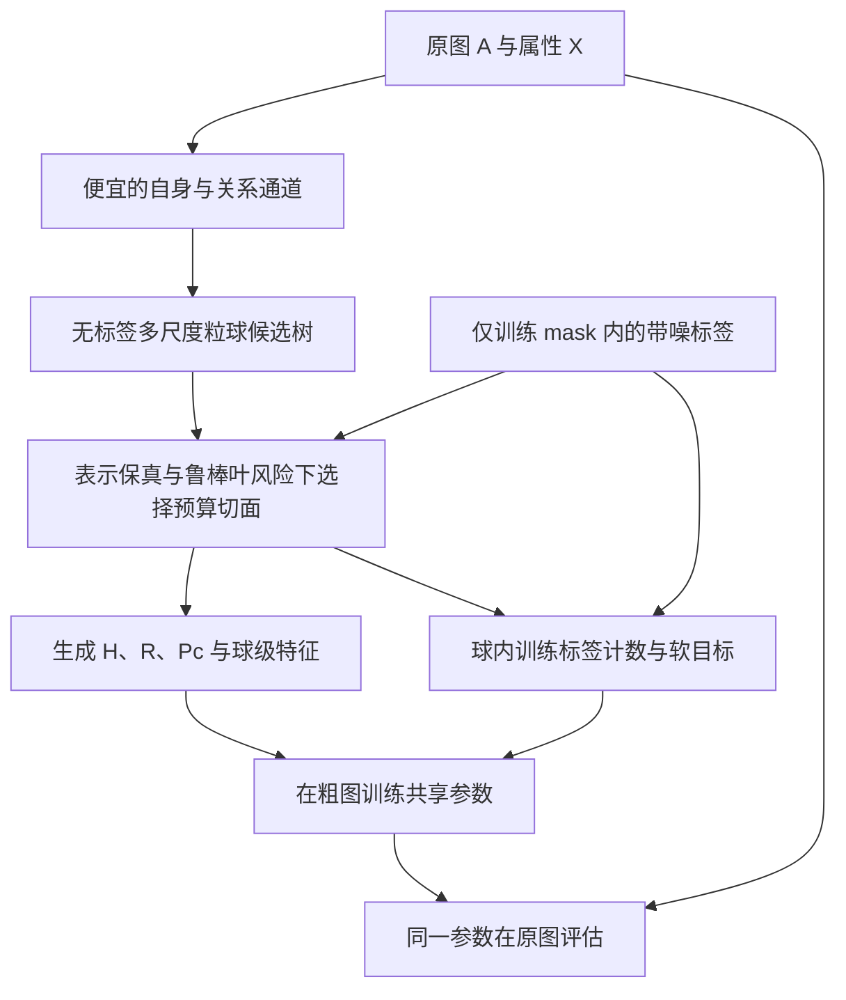

# 文献交叉复核后的算法设计重估

日期：2026-10-19。状态：五领域阅读、跨域裁决和登记核验已完成；算法为待验证研究设计。

本轮只做文献与方法设计审计，没有训练新模型。五领域逐篇卡片、来源、版本和已读范围见03_PAPER_INDEX.md、04_ALL_AGENT_REPORTS.md；主代理独立回查见02_COORDINATOR_AUDIT.md。Luna/max负责分领域方法/实验或理论阅读，主代理针对改变设计的关键断言回读，不声称主代理逐页精读了所有论文。选文依据是直接关联、代表性和近期推进，没有编造被引次数，也不声称穷尽截至今日的SOTA。

| 交叉领域 | 核心篇数 | 本轮主要用途 |
|---|---:|---|
| 粒球生成与粗粒度表示 | 7 | 区分球的生成准则、标签依赖与真正替代的计算 |
| 图粗化、凝缩与计算保持 | 7 | 核对限制/提升、传播算子、压缩风险与全成本 |
| 带噪图学习与鲁棒压缩 | 8 | 对齐噪声和监督协议，明确直接相关先例 |
| 异配表示、传播与粗化 | 7 | 保留自身与关系差异，避免只看同配率或纯度 |
| 可靠分裂、剪枝与预算分配 | 7 | 区分风险、显著性、选择偏差和预算最优性 |

共36篇核心条目，另补SIGN作效率审计来源。ICDE PLGB-FSC没有可读方法全文，因此未计入，以GBG++替代；某些正式论文的方法读取作者版，具体版本差异/未核事项已在卡片记录。登记程序核查了数量、必需字段、声明的阅读深度、题名及已登记DOI/arXiv去重；它不替代逐篇事实审查。

## 1. 结论：保留研究主线，改变实现中心

建议继续研究：**带噪监督下，面向节点分类的预算约束粒球图粗化。**

核心问题不是“怎样分出更多纯球”，而是：**在有限计算预算下，如何减少训练所需的节点与传播计算，同时避免让噪声标签支配粒度分配，并保留分类所需的属性和关系差异？**

与旧GB-LCSS相比，粒球的首要角色从组织投票区域转为实际训练计算单元。异配是检验信息保持能力的关键场景，但第一版不同时承诺解决任意标签噪声、任意异配、结构污染、无图推理和在线动态图。

“有相关先例”不否定这个方向。真正需要形成的新贡献，是在同一套可审计流程里把**抗噪的粒度选择、任务相关的压缩约束、实际训练收益**接起来，并证明这些部分相对直接组合的基线有必要。

### 主代理对各组建议的取舍

- 保留C组强调的“候选生成—监督评分—粗图损失”三部分隔离；其`g+λr`作为贪心评分对照，主规格采用有明确叶代价的树切面目标。
- 采纳E组的鲁棒不纯度和选后偏差分析；精确固定M动态规划用于小图参考。主实现先用每个λ线性遍历的正则化剪枝，避免搜索成本吞掉效率收益。
- 采纳B/D组的原传播算子限制和自身/关系通道分离；首版不叠加完整ACM、ACE投影学习及额外蒸馏损失。
- A组的交叉复核指出固定M时叶数惩罚是常数，此点已改正；连通性则保留为建模选择，不强制所有表示空间粒球连通。
- 置信惩罚V仍是待定义/单独验证的扩展，没有把一个未校准的V写成已解决噪声可靠性的模块。第一版先用D、D+Gini、D+NE三个设置检验是否有值得进一步建模的增量。

## 2. 文献迫使我们修正的六点

### 2.1 不能再把已有方法的缺陷写得过满

SGBGC扩展全文已有五张图、5/10/15/20%均匀错标、多个粗化率的实验。因此不能说“监督粒球粗化从未考虑噪声”。纯度驱动存在追随噪声的机制风险，但球数是否暴涨、何时损害精度，需要在训练mask和预算一致时实测；公开代码还存在预算截断/补充分裂，不应断言必然无限细分。[SGBGC扩展全文](https://arxiv.org/html/2412.13842v1)

MRGC也已包含训练标签随机翻转的实验，包括单列标签攻击情形；它是直接相关先例，不能只归为结构噪声工作。我们的可能差异在低成本的真实节点硬分区、噪声下粒度选择及计算组织，而不在“第一个鲁棒图压缩”。RobGC则明确以干净标签为前提研究结构噪声，不能和MRGC混为一谈。[MRGC](https://arxiv.org/html/2510.26451)，[RobGC](https://arxiv.org/html/2406.13200)

ACE已经直接研究异配图粗化的失真补偿。它使“考虑异配”本身不足以构成贡献，但也提供了需要比较和改进的具体方法。[ACE](https://arxiv.org/html/2607.21885v1)

### 2.2 不把显著性检验当作预算分配目标

显著性回答“观测差异能否由特定零假设解释”，不回答“多花一个球是否值得”。大样本下很小的差异可能显著，小样本下有实际价值的差异也可能不显著。

固定无标签候选树隔离了树生成对标签的依赖，但之后用标签挑选切面，仍会产生选择偏差；不能把选中的经验差异视为无偏真值。诚实分割、交叉拟合或全候选一致控制都有代价，尤其在少标签图上。[Athey与Imbens](https://arxiv.org/html/1504.01132v3)

修改：不再用“父层检验通过才允许向下探索”的规则。先构造有深度/规模上限的无标签候选树，再在树上选择切面。统计支持用于控制标签项的可信度和过拟合，不作为唯一的开关。

### 2.3 优先建立统一的可加性目标，而不是随意相加两种分数

旧草案的`几何收益 + λ×标签显著性`量纲和优化含义不清。建议改成每个叶球的表示损失与监督代理风险，再加复杂度成本。这样能解释到底舍弃了什么、为何细分，以及预算如何限制噪声拟合。

鲁棒树文献已有对称噪声下不纯度排序分析和保守损失；应把它们当必要基线，不能把多数票集中界换成粒球符号就称为新理论。保守损失还可能早停欠拟合，这与项目旧PRUNE负结果相呼应。[2017鲁棒决策树](https://arxiv.org/pdf/1605.06296)，[AAAI2024鲁棒树损失](https://ojs.aaai.org/index.php/AAAI/article/download/29516/30856)

### 2.4 分区、传播算子、粗细图迁移必须分别检查

`Ac=HᵀAH`后重新做GCN归一化，通常不等于先定义原图传播再压缩。球数、特征平均、节点质量和归一化不匹配，都可能造成损失，不能全归因于分球质量。[Message-Passing Guarantees](https://papers.nips.cc/paper_files/paper/2024/file/d041d6bb47c01a4ce327a1773703e9a0-Paper-Conference.pdf)

粗图训练后复制参数到原图，也不等于训练/测试输入分布一致。第一版要用参数维度不依赖节点数的骨干，分别测粗图提升预测与原图重新前向的表现。

### 2.5 球级软标签只是一个必要的压缩基线

设球B内训练标签经验分布为q_B，有n_B个训练节点，共享预测p_B，则

`n_B CE(q_B,p_B) = Σ_{i∈B∩train} CE(e_{z_i},p_B)`。

这是代数恒等式。它避免硬argmax丢掉分布信息，但没有自动删除错误监督。相同噪声机制下，聚合可能减小随机波动，却仍接近被噪声转移后的分布。标签选择、球目标和下游鲁棒损失必须分开验证。

它仍有明确的研究动机：适当共享球级预测会减少逐点拟合独立错标的自由度，可能形成有用的结构正则化；代价是把真正需要区分的成员也平均掉。新粒度规则要做的，就是改善这个“抑制噪声拟合—保留真实差异”的权衡，而不必先声称已经恢复了每个节点的干净标签。

### 2.6 效率必须击败强的便宜基线

SIGN类方法已经把多通道图特征预计算，让可学习部分按MLP方式训练；DnD-Net也采用传播与学习解耦。因此只比每轮传播的GCN快，不能证明粒球带来了必要增益。[SIGN正文](https://grlplus.github.io/papers/77.pdf)，[DnD-Net作者代码](https://github.com/kaize0409/DND-NET)

还应把建树、打分、选择切面、边聚合、原图验证和最终推理都计入。同一球数未必同一粗边数，也未必同一时间。单次任务与多次复用的摊销收益要分开。

尤其在少标签场景：若原图特征已缓存，且只有监督分类损失，原图MLP每轮只需训练L个有标签节点，不必反复处理全部N个节点。粒球版本的有效监督量是M_+个有标签球，而非笼统的M。L很小、M_+≈L时，分类头几乎没有可压缩空间。不能故意让原图基线每轮跑无用的全N前向来制造加速；若粗图省的是传播阶段，应明确该阶段是否也能在原图被预计算。

## 3. 建议的最小算法骨架

验证标签只在预先约定的模型选择环节使用；测试标签只用于最终评估，不进入上图任何生成/训练步骤。

### 输入与协议

输入原图A、属性X、训练mask与带噪训练标签z。验证/测试标签不进入建树、标签统计、软目标或粗化；验证只按事先约定的模型选择协议使用。主协议不要求额外干净训练标签、不输入真实注噪率。干净验证与带噪验证是两种不同协议，不混表。

第一版以转导节点分类为范围：可以使用全图A/X，但只使用训练mask内标签。原图推理允许访问A，graph-free不作为这条主线的约束或默认优点。

### 步骤1：低成本、标签无关的候选坐标

对X做可复现的标准化和低维投影得到U。维数不能直接以“10维足够”为前提，须检查信息损失。保留属性自身与关系通道，例如`U, PU, P²U`，分别归一化；这些是候选描述，不是把三者平均成一个平滑表示。

P²U不等于精确二跳邻居特征；它包含回游、一跳重叠等贡献。是否增设精确二跳/高通通道，应由信息诊断决定，不能仅凭“异配适合二跳”断言。[H2GCN](https://arxiv.org/abs/2006.11468)

### 步骤2：有成本上限的无标签粒球候选树

先用一个便宜且确定的二分规则，记录每个候选球的成员、中心、半径、父子关系和通道SSE。设置最大深度、最小节点量、候选数上限；停止条件不读取标签。它的任务是提供可复用的多尺度计算单元。

第一轮只选一种树，不同时训练自编码器、强化学习器、伪标签教师。候选树不包含有用边界时，任何剪枝规则都救不回来，因此树的候选覆盖是独立假设。

这里使用的是表示空间粒球，未默认要求球内原图子图连通。GBGC式连通图球和几何球属于不同约束；强制连通可能排除异配图中不相邻的同角色节点。第一版必须固定并声明这个选择，不能一边使用非连通几何分组，一边套用只针对连通图球的论证。

### 步骤3：在候选树上选择切面，而非追求纯度1

设切面叶集合为P，覆盖全部节点且互斥。一个可检验的目标模板为

`J(P)=Σ_{B∈P}[D(B)+β·(n_B/n_train)·I_τ(q_B)] + λ·|P|`。

- D(B)：按全局尺度归一化后的属性/传播通道重构损失，即通道球内SSE的加权和。它给没有训练标签的区域也保留信息的理由。
- I_τ(q_B)：标签分布的叶风险代理。普通Gini是必要基线；鲁棒树NE不纯度是一个有文献依据的候选。不能把二分类闭式式子直接移植到70类，也不能宣称鲁棒参数τ等于可知的噪声率。
- n_B：球内训练标签数，不是全部节点数；无训练标签球的标签项为0，但仍参与表示和传播。
- λ：计算复杂度的首轮代理，用于控制叶数；它不是实际毫秒预算，最终仍须实测粗边、内存和时间。β与τ需要有限且相同预算的验证选择。

该式是设计模板，尚未被实验验证。第一轮应固定D、骨干、损失与候选树，分别比较无标签D、D+Gini、D+鲁棒不纯度；不要一开始就增加多个置信/噪声估计网络。

一个具体候选来自AAAI2024正文Theorem 8之后的多分类扩展（此处将论文参数λ重命名为τ，避免与叶数代价混淆）：

`I_NE,τ(q)=min{1−||q||∞, τ·sqrt[(C−1)/C·(1−||q||²)]}, 0<τ≤1`。

这是已有NE（negative exponential）不纯度，不是本项目新公式。由于τ同时改变数值尺度，与D混合时建议用`I_NE,τ/[τ(1−1/C)]`，普通Gini用`(1−||q||²)/(1−1/C)`，使最大值都为1。这一归一化仅控制标签项权重混淆，不是噪声校正；其混合目标适用性仍须验证。

仍有一个未解决的实质问题：n_B=1时经验Gini和NE都为0，经验“纯”不代表可靠。叶预算、几何项和鲁棒不纯度都不能自动消除孤立噪声的诱惑。第一轮须专门检查标签稀疏时收益是否消失；若必须加入支持度/选后控制，应把它作为明确的新增机制单独验证，不能仅把n_B加权改称“可靠性估计”。

若各叶代价可加，可按`F(B)=min(a(B)+λ,F(left)+F(right))`自底向上剪枝。它能看到父层以下的累积收益，不要求每一步即时收益均过阈值。每个λ只需遍历候选树，适合最小实现。这个解只对固定树及加性代理最优，不是对所有图划分或最终GNN风险最优。

固定M的精确DP可以在小图作参考，但大预算开销可能抵消粗化收益。λ扫描也不保证能产生每个整数M；比较时匹配实际叶数，或明确近似预算偏差，不能静默混用。

特别区分：严格固定M时，λ|P|=λM是常数，不能影响哪个切面被选中；这时只优化其余项。可变叶数的正则化剪枝与固定M的机制比较是两个设置，不混称同一预算优化。实际粗边数等成本通常跨球耦合，不能未经证明就作为单叶代价塞进该递推。

### 步骤4：一致地限制、传播和提升

令H为N×M的硬归属矩阵，每行一个1，球非空；R=(HᵀH)⁻¹Hᵀ。

`X_c=RX, P_c=RPH, lift(Z_c)=HZ_c`。

H、R和正交归一化的谱投影不是同一个矩阵。Pc按上述定义后，不再交给默认GCN归一化修改。保留自环/质量信息，另把传统Ac重归一化作为对照。

为何用通道重构D：令Π=HR，提升的一步粗传播为ΠPΠU。可以直接推出

`||PU−ΠPΠU||_F ≤ ||(I−Π)PU||_F + ||P||_2·||(I−Π)U||_F`。

右侧两类重构误差可按球加和，给D提供一个清楚的代理含义。它不是最终准确率保证；对多层非线性网络还需要额外条件。单独要求传播“交换关系”好，可能偏爱退化分区；同时保留自身属性和传播后信号，更符合实际压缩目的。

### 步骤5：粗图训练，原图评估

先采用一个参数维度不依赖N、区分自身与传播通道的简单骨干，按n_B加权的soft CE训练。无标签球参与图传播但不直接贡献监督损失。该版本用于隔离分球/传播的收益，不把soft CE称为新的抗噪损失。

同一参数θ在原图上评估，同时报告粗预测提升回原图的结果；两者差距用来诊断迁移失配。若只有增加复杂下游纠错器才有收益，应单独重新定位贡献，不能把它归给粒球生成。

## 4. 粒球究竟承担什么

1. **计算压缩单元**：让主要可学习前向/反向从N个节点转为M个球及其粗关系。
2. **多尺度预算单元**：有信息差异的区域分配更多叶球，冗余区域共享表示；不以每个球都纯为目标。
3. **可审计监督汇总单元**：保存训练标签计数和不确定性，避免直接把硬众数当真实标签。

中心/半径仅用于描述和产生区域还不够证明“粒球不可替代”。需要固定同一树、同一预算的强剪枝对照，确认球的层次组织及分配规则确实贡献价值。如果任意廉价分区都等价，应如实把贡献定位于抗噪任务粗化，而不把“粒球”当性能解释。

## 5. 关键假设和失败条件

| 假设 | 如何失败 | 最小检查 |
|---|---|---|
| 存在可压缩的任务信息 | 同球平均抹去少数类/角色差异 | 固定预算下的类召回、属性/传播重构、粗细预测差 |
| 便宜候选树包含有用边界 | 与类别相关信息被低维投影丢弃，或拓扑候选切错 | 同树不同切面与候选覆盖诊断；干净标签仅作分析参照 |
| 训练标签有足够且有代表性的支持 | 大量球无标签/单标签，少数类集中在被合并区域 | 每球n_B、覆盖率、类条件支持量；与纯D比较 |
| 噪声没有完全毁掉判别信息 | 类条件偏置或实例相关翻转使区域差异指向错误语义 | uniform、pair分别检验，实例相关噪声只作后续压力测试 |
| 标签选择没有严重过拟合 | 高分切面只适应这一次噪声实现 | 固定候选树、多次独立注噪及选后评估；必要时诚实分割诊断 |
| 粗图计算可以摊销成本 | 构树/DP/原图验证成为瓶颈 | 全流水线计时，单次与多次复用分别报告 |
| 骨干能利用保留的关系 | GCN本身不适合该异配任务 | 原图与粗图使用同一骨干；另设多通道骨干控制 |

条件独立标签翻转允许对固定图/干净标签做噪声集中分析，不自动允许把节点当iid样本做所有统计推断。固定同率对称噪声可以得到更强性质；未知类条件或实例相关噪声下，不承诺干净风险排序普遍保持。

## 6. 理论值得做什么，不值得包装什么

值得尝试的两条窄而连贯的分析：

- 固定无标签候选树中，标签噪声与有限样本如何影响切面评分/选择；显式区分固定分区结论与自适应选树后的结论。
- 给定切面，属性及传播通道重构误差怎样约束粗传播近似误差；说明增加粒度改善什么、成本是什么。

根代理已推导一个可继续检查的现象：在固定干净训练节点、独立同率对称翻转下，经验Gini总风险的期望包含`−v×有标签球数`的有限样本项，v由噪声机制确定。因此固定总球数不等于固定有标签球数，经验标签纯度可能偏好更多碎片。它不是现成的实用校正算法：η未知，不能将实验注噪真值直接输入主方法。推导条件和小例枚举核对见02_COORDINATOR_AUDIT.md。

不应包装的内容：通用多数投票Hoeffding界、已有RPH粗传播公式、soft CE恒等式、固定树剪枝DP。这些可以作为工具，新增贡献必须来自对本问题的组合机制、边界分析和验证。

## 7. 下一阶段只验证三件事

本轮不启动训练，以下是后续实验的收敛路线。

**诊断一：真实缺口。** 对SGBGC保留作者流程记录，另建训练mask受限且不改变原split的适配版；分别检查噪声对球数/有标签球数/单节点比例、监督质量、粗图边数、精度和总时间的影响。GBGC原任务为图分类，迁移到节点分类须明确适配，不能把迁移失败当作原文错误。异配条件下不能只用球内混类率判断失败。

**诊断二：生成规则是否有增量。** 同一无标签树、同一实际M、同一Pc和骨干，只比较D、D+Gini、D+鲁棒不纯度；以纯度驱动生成作为外部对照。先证明粒度选择有价值，再考虑复杂纠错/更强表示。记录少标签球、少数类召回、选面稳定性和重构误差，不仅看Accuracy。

**诊断三：是否值得压缩。** 同条件比较原图骨干、原图预计算多通道分类器、粗图方案；另将一个合适的鲁棒方法按同一噪声协议重跑。用准确率—完整时间—显存曲线判断，而不是预先承诺“必须快5倍、只差2pp”。3pp可以作为预注册的工程筛查阈值之一，不能替代重复seed、方差与应用成本判断。

如果只有诊断一成立而诊断二不成立，不能宣布新算法成功。如果诊断二有增益但诊断三无收益，则可能有可靠性研究价值，却不能主打高效粗化。如果异配收益不稳定而带噪同配图有效，可以收窄题目，不强行保留第二条主张。

## 8. 与既有项目负结果的关系

旧PRUNE出现根部过早收缩，说明“保守”也可能毁掉监督；本方案通过预建候选树和子树累计目标避免同一种局部门控，但并没有因此免于过粗风险。纯度、SSE或Brier改善不必然提升最终准确率，必须延续旧项目的末端分类验证。

过去的空间替换/投票实验不能直接否定计算粗化；反过来，也不能因为换了研究表述就重复同样的投票机制。这里必须实际改变训练计算路径，并清楚记录收益来自分区、传播近似还是训练损失。既有实验依据见research/core_redesign_20261019/Claude方案评议_20261019.md及其追溯文件；本轮没有把猜测补写成实验结果。
